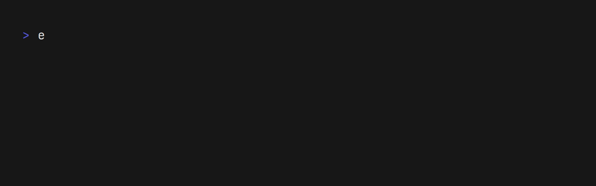

# GradientProgressBar

A small, self-contained wrapper around [`indicatif::ProgressBar`](https://docs.rs/indicatif) that gives your program a consistent, beautiful look across every operation without repeating `ProgressStyle` boilerplate.
\
\
🔵 Human-written — Written entirely by humans. (*except for `\x1b[38;2;{};{};{}m█` and `█▉▊▋▌▍▎▏  ` visual elements, which I asked a large language model to provide.*)

> [!NOTE]
> `GradientProgressBar` was originally made for [Enkryptit](https://github.com/VRAM-RAM/Enkryptit) but went too far with gradients.

<div align="center">
  
</div>

## Quick start

The most common case - you know the total size in bytes:

```rust
use gradient_bar::progress_bar::GradientProgressBar;

let bar = GradientProgressBar::with_total_bytes(total_size, "Operating...");

// ... inside your processing loop ...
bar.inc(bytes_processed);   // or bar.update(position);

bar.finish();
```

That's it. A green spinner, a wide cyan/blue bar, `bytes/total`, percent and ETA are all handled for you.

## Constructors

| Method | Style used | When to use it |
| --- | --- | --- |
| `new(len, msg, style, gradient)` | any | Low-level: you pick the total *and* the style *and* the gradient yourself. |
| `with_total_bytes(total, msg)` | `Main` | Byte-based workload (streams, single-file encrypt/decrypt). |
| `with_total_steps(total, msg)` | `Steps` | Chunk / step-based workload, e.g. multithreaded splitting. |
| `with_gradient(total, msg, gradient)` | `Main` | Byte-based workload with a specific [`Gradient`]. |
| `with_wide_bar(total, msg)` | `Main` | Byte-based workload with the classic two-tone bar (no true-color gradient). |
| `new_spinner(msg)` | `Spinner` | Indeterminate progress — you don't know the total up front. |

All constructors take the message as `impl Into<String>`, so `"Encrypting"` and `format!(...)` both work.

### Styles

`BarStyle` is a `Copy` enum with a hand-tuned style per variant:

| Variant | Renders as | Best for |
| --- | --- | --- |
| `Main` | spinner + msg + elapsed + wide bar + `bytes/total` + % + ETA | Default byte-based progress. |
| `Minified` | spinner + msg + `bytes/total` + % | Tight output, secondary lines. |
| `Steps` | spinner + msg + bar + `pos/len chunks` + % + elapsed | Chunk counts, not bytes. |
| `Spinner` | spinner + msg | Unknown/indeterminate totals. |
| `ClearOnFinish` | same as `Main` | When you want a pristine terminal afterwards. |

> **How clearing works:** indicatif decides "clear on finish" at finish time, not in the style.
> So for `ClearOnFinish` you must call **`finish_and_clear()`** — not `finish()` — otherwise the
> bar stays on screen. The other variants pair with `finish()`.

Every template uses colors safe on both light and dark terminals, and degrades gracefully
(plain ASCII) on terminals without unicode support.

### Gradients

`Gradient` is an enum that provides **Gradients** for the progress bar.

| Variant | Look |
| --- | --- |
| `Ocean` | Deep blue to Ice cyan (the signature look) |
| `Violet` | Violet to Magenta |
| `Sunset` | Warm orange to gold |
| `Mint` | Aqua green to mint |
| `Ember` | Amber to rose |
| `Ice` | Cool white to pale blue |

*Gradients* are rendered using `std::fmt::Write`.

### Driving the bar

All methods take `&self` - no `mut` needed to drive it.

| Method | What it does |
| --- | --- |
| `update(pos)` | Jump to an absolute position. |
| `inc(delta)` | Advance by `delta` (most common in loops). |
| `set_length(len)` | Change the total. |
| `inc_length(delta)` | Grow the total by `delta`. |
| `set_message(msg)` | Update the message text. |
| `tick()` | Redraw an indeterminate spinner. |
| `finish()` | Mark done and leave the bar on screen. |
| `finish_with_message(msg)` | Mark done, replacing the line with `msg`. |
| `finish_and_clear()` | Mark done and remove the bar entirely. |
| `set_style(style)` | Swap the layout of an existing bar. |
| `style()` | Read the current style back. |
| `set_gradient(gradient)` | Swap the gradient (or set `None` for the classic two-tone bar). |
| `gradient()` | Read the current gradient back. |
| `set_bar_width(width)` | Set the number of columns the gradient bar occupies. |
| `inner()` | Borrow the underlying `indicatif::ProgressBar` for advanced use. |


### Sharing across threads

`GradientProgressBar` is `Clone`, `Send` and `Sync` (its inner `ProgressBar` is). This makes it trivial to report progress from worker threads:

```rust
use gradient_bar::progress_bar::GradientProgressBar;
use std::sync::Arc;

let bar = Arc::new(GradientProgressBar::with_total_steps(num_chunks, "Splitting"));

let handles: Vec<_> = (0..8).map(|i| {
    let bar = bar.clone();
    std::thread::spawn(move || {
        // ... do work ...
        bar.inc(1);
    })
}).collect();

for h in handles { h.join().unwrap(); }
bar.finish();
```

### Real-world patterns

#### Byte-based stream (like `encrypt_stream` / `decrypt_stream` in Enkryptit)

```rust
let bar = GradientProgressBar::with_total_bytes(total_size, "Encrypting");

while n > 0 {
    // ... read, compress, encrypt, write ...
    total_processed += n as u64;
    bar.update(total_processed);
}

bar.finish();
```

#### Step-based multithreading

```rust
let bar = GradientProgressBar::with_total_steps(estimated_max_steps, "Splitting");

loop {
    // ... read a chunk, submit a job ...
    step += 1;
    bar.update(step);
}

bar.finish();
```

> The `Steps` bar displays `pos/len chunks`. It does **not** take a byte count, so keep feeding it chunk positions, not accumulated bytes.

#### Indeterminate stage + success message

```rust
let sp = GradientProgressBar::new_spinner("Deriving key");
sp.tick();

// ... long-running work with no known total ...

sp.finish_with_message("Key ready");
```

#### Clean up afterwards

```rust
let mut bar = GradientProgressBar::new(total, "Packaging".into(), BarStyle::ClearOnFinish, None);
// ... bar.update(x) ...
bar.finish_and_clear();
```

### Tips

- In a non-interactive context (piped output, CI) indicatif **automatically hides** the bar, so you get clean logs for free.
- Prefer `inc()` when you know each step's size; use `update()` to jump to precise positions.
- Run `cargo fmt` after editing files that embed these snippets.

## License

`gradient-bar` is licensed under :

- [MIT](./LICENSE-MIT)
- [CECILL](./LICENSE-CECILL-EN) (French / European law compliant)

Choose the one that best fits your needs !